<p align="center">
  
</p>

<h1 align="center">Taproot</h1>

<p align="center">
  <strong>Grow big projects from one idea.</strong><br>
  A self-hosted project canvas for work that takes weeks, with an MCP server and REST API so your AI agents can work on it alongside you.
</p>

<p align="center">
  <a href="https://github.com/j4ckxyz/taproot/actions/workflows/ci.yml"></a>
  <a href="https://github.com/j4ckxyz/taproot/pkgs/container/taproot"></a>
  <a href="LICENSE"></a>
</p>

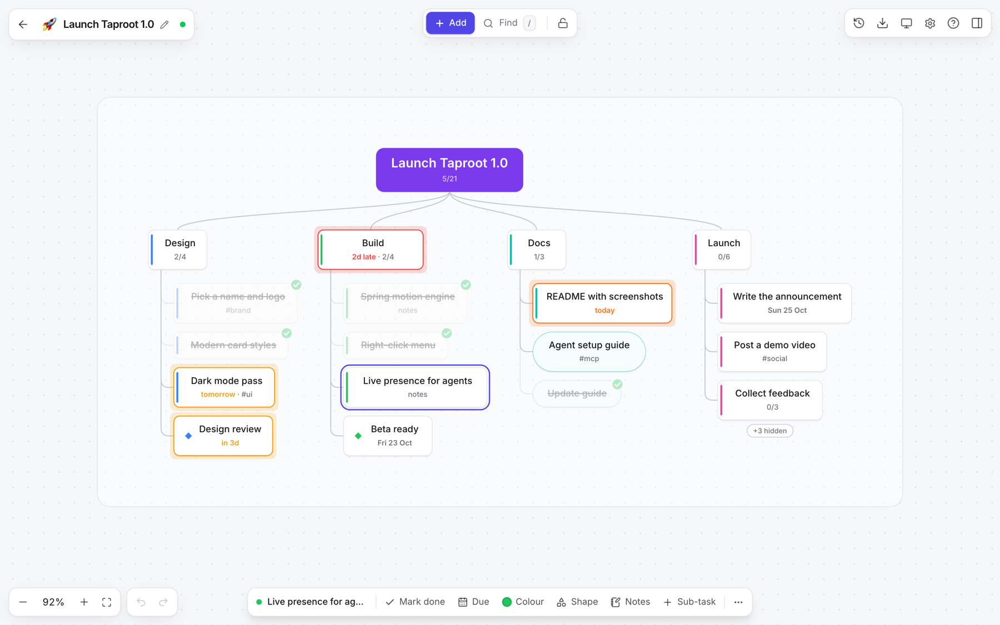

Put the idea at the top, branch out into the steps it takes, and check them off as you go. Done items fade but stay put, so you can see how far you've come. Every project is also open to AI agents (Claude, ChatGPT, Grok or your own): they can read it as JSON, Markdown, Mermaid or a picture, and, with a token you've allowed to write, add and tick off work while you watch.

<p align="center">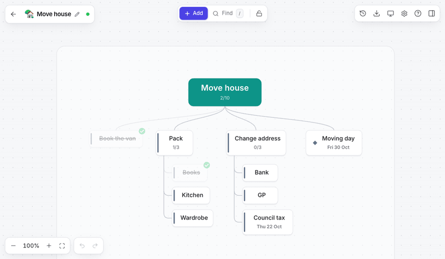</p>

## Features

| | |
| --- | --- |
| 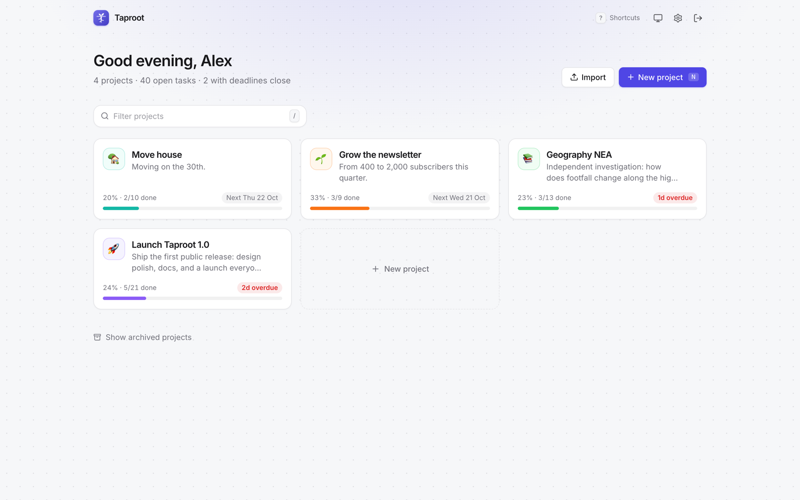 | 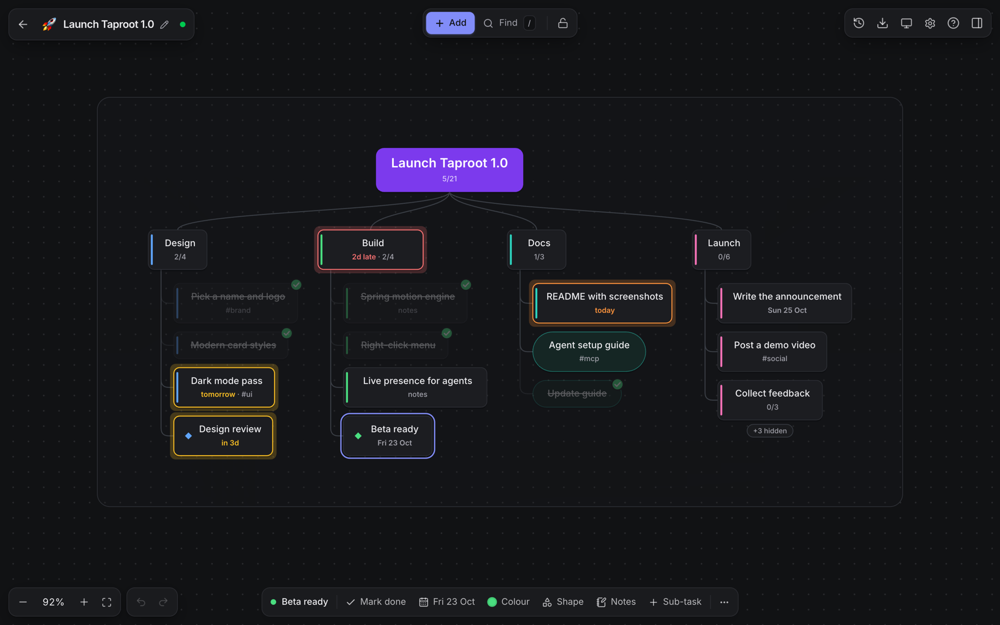 |
| **Projects at a glance.** Progress, the next deadline and anything overdue. Create one with just a name. | **Light and dark.** Follows your system, with eight accent colours. |
| 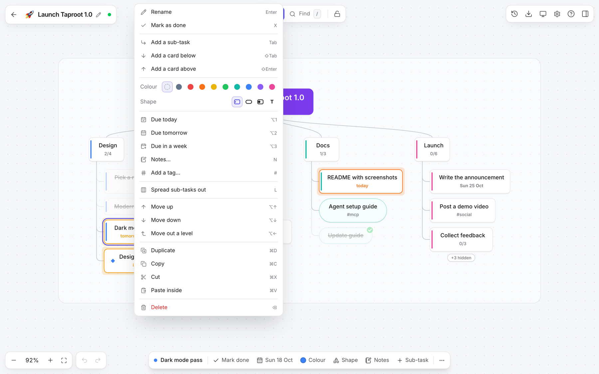 | 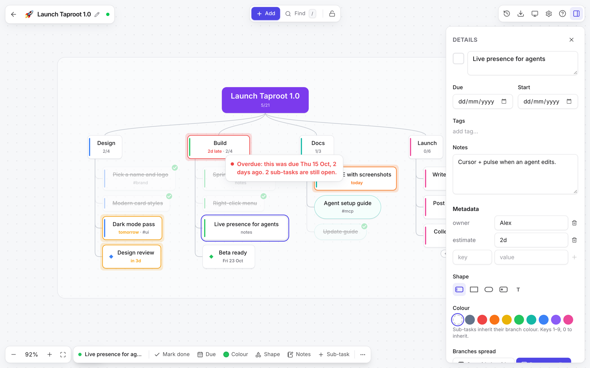 |
| **Everything on right-click**, with the shortcut beside each action. A bar at the bottom holds what you change most. | **Deadlines that speak up.** Due-soon cards glow amber, overdue ones red, and hovering says why. Notes, tags, dates and your own fields live in the details panel. |
| 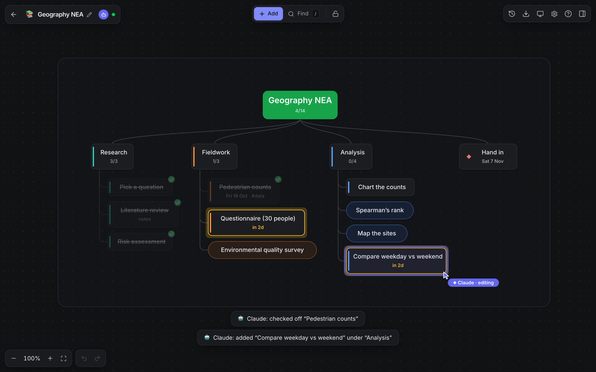 | 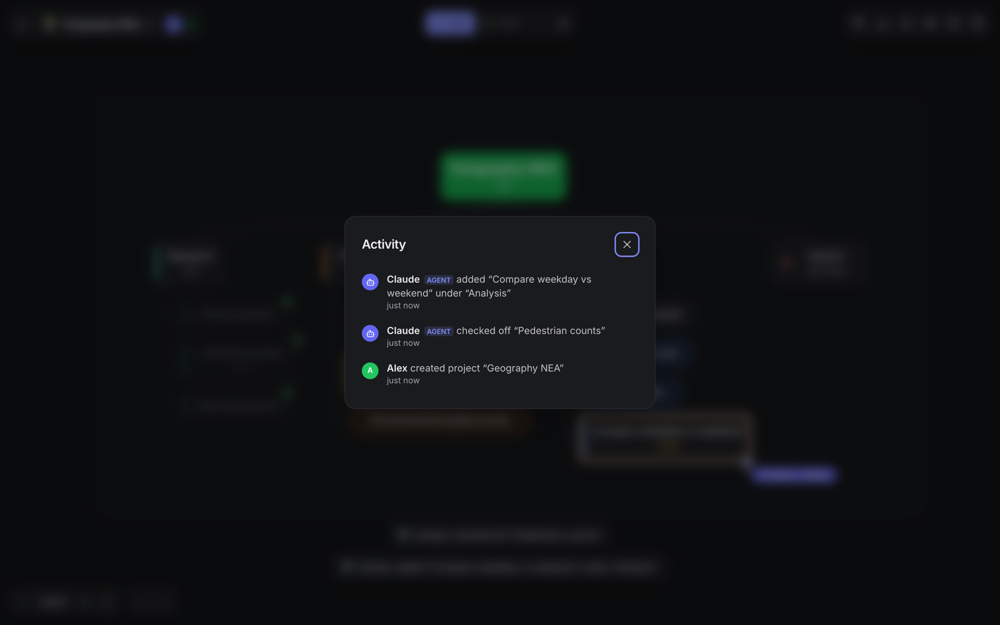 |
| **Watch agents work.** An agent gets an avatar and a labelled cursor that follows what it edits; changed cards pulse in its colour. Other tabs and people show up too. | **Who changed what.** A live activity log in plain words. Click an entry to jump to the card. |
| 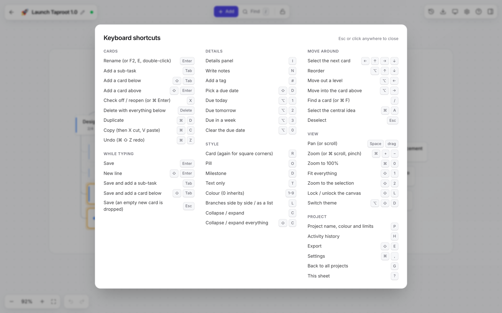 | 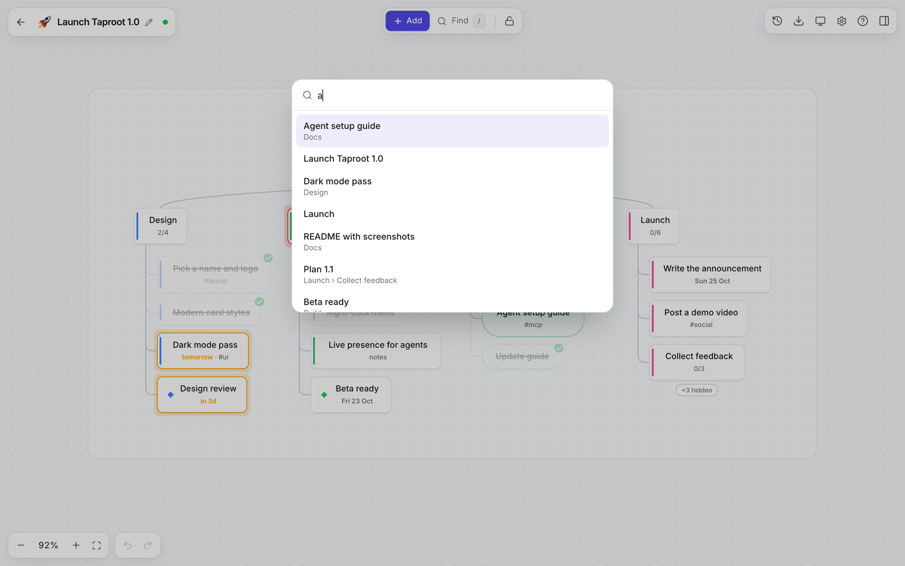 |
| **A shortcut for everything.** Press `?` for the sheet. | **Find any card** with `/`. |
| 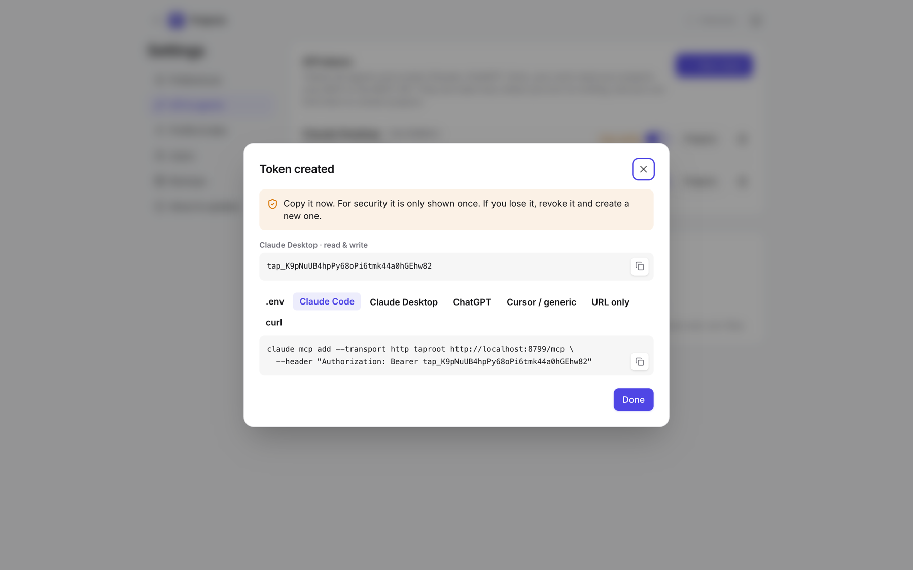 | 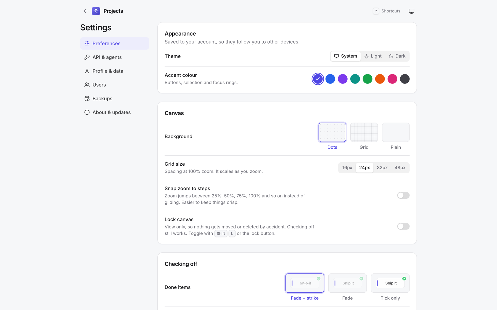 |
| **Connect an agent in a minute.** Tokens are read-only unless you allow writing, can be limited to projects, and come with copy-paste setup for Claude Code, Claude Desktop, ChatGPT, Cursor and more. | **Make it yours.** Theme, accent, dots/grid/plain backdrop, snap zoom, a view-only lock, how done items look, and motion. |
| 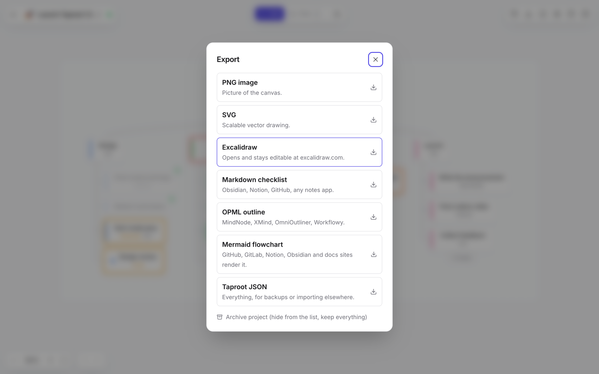 | 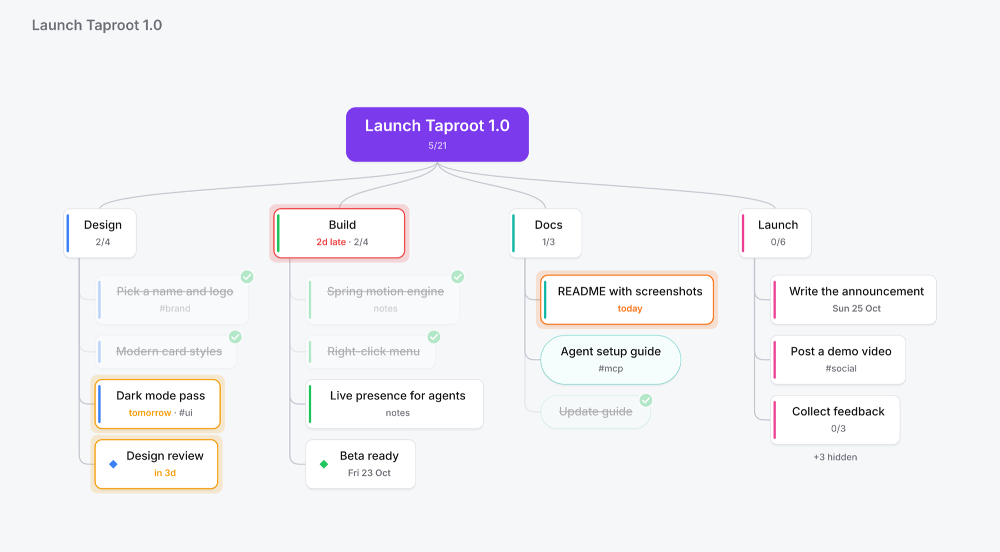 |
| **Take it anywhere.** PNG, SVG, Excalidraw, Markdown, OPML, Mermaid and JSON. Import Markdown, OPML and JSON. | **What agents see.** `get_project_image` renders the same picture you see. |

And also:

- **A canvas with edges, flowing downwards.** Any card can spread its sub-tasks out sideways or list them down its side, and each project caps depth and branching so big plans stay readable.
- **Cards, pills, milestones and plain text** in nine colours. No freehand drawing.
- **Fast and bubbly.** Cards spring into place and nudge their neighbours; checking off is instant.
- **Multi-user.** Everyone has private projects and tokens; admins manage users and backups.
- **Live sync** across tabs, devices and agents, with an activity log of who did what.
- **Small, automatic backups** (gzipped SQLite, usually a few KB) on a schedule, on demand, and before every upgrade.

## Get started

### Docker (recommended)

```sh
mkdir taproot && cd taproot
curl -fsSLO https://raw.githubusercontent.com/j4ckxyz/taproot/main/docker-compose.yml
docker compose up -d
```

Open http://localhost:8787 and create the first account; it becomes the admin. Your data lives in the `taproot-data` volume. Images are built for `amd64` and `arm64` (so a Raspberry Pi works too).

Prefer a single command?

```sh
docker run -d --name taproot -p 8787:8787 -v taproot-data:/data --restart unless-stopped ghcr.io/j4ckxyz/taproot:latest
```

To use it from other devices or hosted agents, put it behind a reverse proxy with HTTPS (Caddy, Traefik, nginx) and set `PUBLIC_URL` and `SECURE_COOKIES=true` (see [`.env.example`](.env.example)). ChatGPT and most hosted agents need HTTPS to reach your MCP server.

### Node

Requires Node 22.13+ (it uses the built-in `node:sqlite`, so there's no database driver to compile).

```sh
git clone https://github.com/j4ckxyz/taproot.git && cd taproot
npm ci
npm run build
npm start                 # http://localhost:8787
```

### Try it with demo projects

```sh
TAPROOT_URL=http://localhost:8787 TAPROOT_EMAIL=you@example.com TAPROOT_PASSWORD=your-password npm run seed:demo
```

Adds the four demo projects from the screenshots (on a fresh server it also creates the admin account with those details).

## Updating

Releases are listed on the [releases page](https://github.com/j4ckxyz/taproot/releases), and admins see "Update available" in the app (Settings → About & updates) when there's a new one.

```sh
# Docker
docker compose pull && docker compose up -d

# Node
npm run update            # git pull, install, build; then restart the server
```

Your data is never touched by an update. If a new version changes the database, a `pre-upgrade` backup is written to `DATA_DIR/backups` first. To stay on a version, pin the image tag, e.g. `ghcr.io/j4ckxyz/taproot:0.1`.

## Using it

- **Start:** create a project with just a name (icon and colour are picked for you) and you're straight into typing the first step.
- **Add:** press `Tab` (sub-task) or click **Add**. Double-clicking empty paper adds a branch too.
- **Rename:** click a selected card again, double-click it, or press `Enter`.
- **Everything else:** right-click a card (or the paper) for every action, or use the little toolbar above the selected card: done, due date, colour, shape, notes and more.
- **Live:** other tabs, people and agents show up as avatars and labelled cursors. Cards someone else changes pulse in their colour, and the activity log (`H`) says who changed what. Click an entry to jump to that card.

## Keyboard

Press `?` anywhere for the full sheet (Esc or a click closes it).

| Keys | Action |
| --- | --- |
| `Enter`, `F2`, `E`, double-click, click again | Rename the selected card |
| `Tab` / `Shift+Tab` / `Shift+Enter` | Add a sub-task / a card below / a card above |
| While typing: `Enter`, `Tab`, `Shift+Tab`, `Esc` | Save / save and add a sub-task / save and add a card below / save |
| `X` or `⌘/Ctrl+Enter` | Check off or reopen |
| `Delete` | Delete a card and everything below it |
| `N`, `#`, `Shift+D` | Notes, add a tag, pick a due date |
| `Alt+1` / `Alt+2` / `Alt+3` / `Alt+0` | Due today / tomorrow / in a week / clear |
| `R` `O` `D` `T` | Card (press again for square corners), pill, milestone, text |
| `1`–`9`, `0` | Colour, or inherit the branch colour |
| `L`, `C`, `Shift+C` | Spread out or list sub-tasks; collapse; collapse or expand everything |
| Arrows, `Alt+Arrows` | Move the selection; reorder, move out or into the card above |
| `/` or `⌘/Ctrl+F` | Find a card |
| `⌘/Ctrl+Z`, `⌘/Ctrl+Shift+Z` | Undo, redo |
| `⌘/Ctrl+D` / `C` / `X` / `V` | Duplicate / copy / cut / paste (pasted plain-text lines become cards) |
| Scroll, `Space`+drag, `⌘/Ctrl`+scroll | Pan, pan, zoom |
| `Shift+1`, `Shift+2`, `⌘/Ctrl+0` | Fit everything, zoom to selection, 100% |
| `I`, `H`, `P`, `Shift+E` | Details panel, activity, project settings, export |
| `Shift+L`, `Alt+Shift+D` | Lock the canvas, switch theme |
| `G`, `⌘/Ctrl+,` | Back to all projects, settings |
| Home: `N`, `1`–`9`, `/`, `U`, `A` | New project, open a project, filter, import, archived |

You can also drag a card onto another to move it there, or drop it near a sibling's edge to reorder.

## Connecting agents

1. In **Settings → API & agents**, create a token. It's read-only by default. You can allow writing and limit it to particular projects, now or later.
2. The token is shown once, along with ready-to-paste setup for each client:

**Claude Code**
```sh
claude mcp add --transport http taproot https://your-host/mcp --header "Authorization: Bearer tap_…"
```

**Claude Desktop** (`claude_desktop_config.json`)
```json
{ "mcpServers": { "taproot": { "command": "npx", "args": ["-y", "mcp-remote", "https://your-host/mcp", "--header", "Authorization: Bearer tap_…"] } } }
```

**Cursor, VS Code, Windsurf and other clients that take a URL plus headers**
```json
{ "mcpServers": { "taproot": { "url": "https://your-host/mcp", "headers": { "Authorization": "Bearer tap_…" } } } }
```

**ChatGPT, claude.ai connectors, Grok and other clients that take only a URL:** use `https://your-host/mcp/t/tap_…` with "no authentication". The token is part of that URL, so treat the URL like a password. You can turn this off with `MCP_ALLOW_TOKEN_IN_URL=false`.

**Your own agents** (`.env`)
```sh
TAPROOT_URL=https://your-host
TAPROOT_TOKEN=tap_…
```

### MCP tools

| Tool | Access | What it does |
| --- | --- | --- |
| `list_projects` | read | Projects with progress, next deadline and limits |
| `get_project` | read | Every node as JSON (with deadline explanations), a compact Markdown outline, or a Mermaid flowchart |
| `get_project_image` | read | PNG of the canvas, exactly as it looks in the app |
| `search` | read | Nodes by text, tag, status or due date, across projects |
| `upcoming_deadlines` | read | Open tasks that are overdue or due within N days |
| `get_activity` | read | Recent changes and who (or which agent) made them |
| `create_project`, `add_nodes` | write | Create projects and nested task trees in one call |
| `update_node`, `set_done`, `move_node`, `delete_node` | write | Edit, check off, move, delete |
| `apply_ops` | write | An atomic batch of create/update/delete |

Write tools only appear for tokens that have write access.

While an agent reads or edits a project, anyone who has it open sees the agent live: an avatar, a labelled cursor on the card it last touched, a pulse on what changed, and a line in the activity log.

### REST API

- Base: `/api/v1` with `Authorization: Bearer tap_…`
- Interactive docs: `/api/docs`. OpenAPI: `/api/openapi.json`. Agent primer: `/llms.txt`
- Highlights: `GET /projects`, `GET /projects/{id}`, `GET /projects/{id}/outline`, `GET /projects/{id}/export?format=png|svg|excalidraw|markdown|opml|mermaid|json`, `POST /projects/{id}/ops`, `GET /deadlines?days=14`, `GET /projects/{id}/events` (Server-Sent Events), `GET|POST /projects/{id}/presence` (who is looking)

## Backups and data

- Automatic snapshots go to `DATA_DIR/backups` every `BACKUP_INTERVAL_HOURS` (default 24), keeping `BACKUP_KEEP` (default 14). Admins can back up now, download or delete backups in **Settings → Backups**.
- To restore, stop the server and then run `npm run restore -- <backup-file>` (Docker: `docker compose run --rm taproot node dist/server/cli.js restore <file>`). The current database is saved as a `pre-restore` backup first.
- Backups are plain gzipped SQLite files. Each user can download all their projects as JSON from **Settings → Profile & data**.
- Other admin commands: `npm run backup` and `npm run create-user -- <email> <password> [--admin]`.

## Configuration

See `.env.example`. Every setting is optional.

## Development

```sh
npm ci
npm run dev             # API on :8787, Vite with hot reload on :5173
npm test                # unit tests
npm run test:e2e        # browser tests (uses your installed Chrome)
npm run typecheck
```

## Project layout

```
shared/   model types, tree helpers, waterfall layout, deadline logic, SVG renderer (used by browser and server)
server/   Hono app: auth, REST API, MCP server, exports, backups, SQLite store
web/      React + Tailwind client (canvas, details panel, settings)
tests/    Vitest suites (npm test)
```
